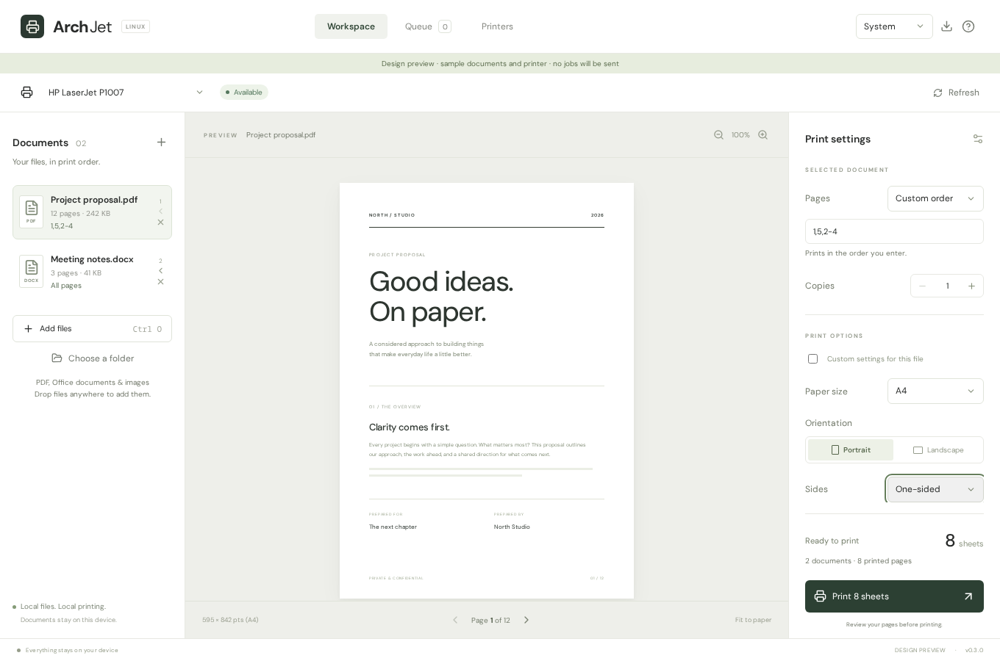

# ArchJet

A local printer workspace for Linux, built for Arch and Hyprland. Arrange your documents, choose the exact pages, preview and print through CUPS. [Website and guide](https://archjet.vercel.app) · [Download](https://github.com/wrestle-R/ArchJet/releases/latest)



```sh
curl -fsSL https://raw.githubusercontent.com/wrestle-R/ArchJet/main/scripts/install-app.sh -o /tmp/install-archjet.sh
bash /tmp/install-archjet.sh
```
