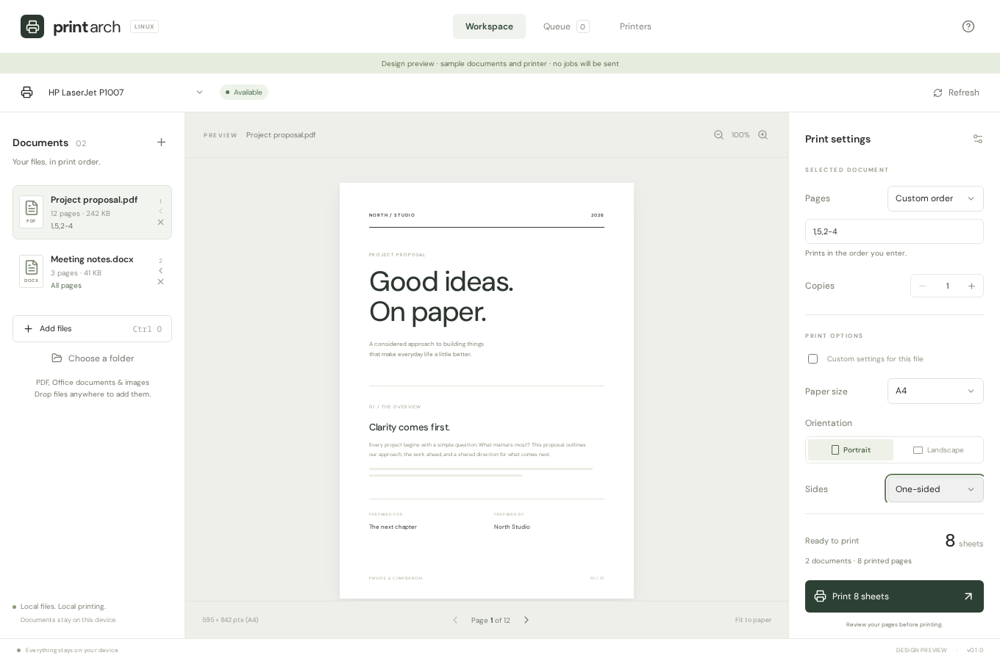

# Print Arch

A quiet workspace for local printing on Linux. Add documents, arrange the exact pages, check the preview, and send them to a CUPS printer.



## What works

- Native desktop file and folder pickers through the XDG desktop portal, plus file drop.
- Folder review with optional subfolders; PDFs, DOC/DOCX, ODT, RTF, PPTX, XLSX, PNG, JPEG, TIFF and WebP.
- Local office conversion, image conversion, document snapshots and page preview.
- Multiple files with drag ordering and a keyboard-accessible move-earlier button.
- All, odd, even and custom pages. `1,5,2-4,1` preserves that exact sequence, including the repeated page. Reverse ranges work too.
- Per-document pages and copies; shared paper, orientation, scaling and sides controls with optional per-file overrides.
- CUPS printer discovery and driver-reported paper, duplex and colour capabilities. Printer setup opens the local CUPS administration page.
- HP LaserJet P1007 profile: USB presence check and 600 DPI grayscale raster output. Queue/firmware recovery is an explicit action.
- Live local queue, targeted job cancellation and structured IPP job state. Unknown outcomes are not reported as success; a repeated submission token is blocked.
- A normal resizable Linux window, native decorations, keyboard file shortcut and narrow-window settings drawer.

This targets **printers supported by your local CUPS installation**. It does not include every manufacturer's driver, and cannot promise support for every printer. Driverless IPP printers use their configured CUPS queue; other hardware needs its Linux driver. The P1007 has been exercised on real hardware. CUPS completed the jobs, but physical output quality remains unconfirmed. See the copy-accounting finding below.

## Session cleanup

This app deliberately keeps no document history or saved settings between sessions.

Closing offers **Finish printing, then exit** or **Cancel all printing and exit**. The latter cancels **all pending jobs on the local CUPS server**, including jobs submitted by other apps. Finish waits for every local queue to clear first. The UI explains this scope before exit. Documents, conversion files, drafts and app settings are cleared.

A detached watchdog attempts the same cleanup if the GUI is killed. If the watchdog is also killed or the machine loses power, a private recovery marker lets the next launch retry cleanup before allowing new submissions. A permissions failure is reported rather than claiming cleanup succeeded. Completed-job records managed by CUPS, printer firmware buffers, and system logs are outside app-history cleanup; paper already printed cannot be recalled. This is not a secure-erasure tool.

## Arch Linux setup

Build prerequisites:

```sh
sudo pacman -S --needed base-devel rust nodejs npm webkit2gtk-4.1 gtk3 librsvg python cups poppler
sudo systemctl enable --now cups.service
```

Optional document converters and HP support:

```sh
sudo pacman -S --needed libreoffice-fresh imagemagick
# Only for HP devices which require HPLIP:
sudo pacman -S --needed hplip
# For models requiring the proprietary plugin, review its licence and install:
hp-plugin -i
```

If you use an AUR helper, the app can show `yay -S hplip-plugin` or `paru -S hplip-plugin` when appropriate. It never runs package installation or sudo commands for you. Driverless printers do not need HPLIP.

Under Hyprland, install and configure `xdg-desktop-portal-hyprland` and a file chooser backend such as `xdg-desktop-portal-gtk` or KDE's backend. The native dialog uses the portal; your portal configuration chooses the actual file picker.

## Develop

Use Node.js 22 LTS or newer and a current stable Rust toolchain.

```sh
npm ci
npm run desktop
```

Browser-only design preview:

```sh
npm run dev
# Open http://127.0.0.1:1420/?demo
```

The browser preview explicitly labels sample data. Real file access and printing require the desktop app. No cloud services, account, API key or environment file is required.

## Build and install locally

```sh
npm ci
npm run tauri -- build --no-bundle
bash scripts/install-local.sh
```

This installs the binary, icon and desktop launcher under your user data directory, without sudo. Open **Print Arch** from your desktop launcher. Run the same commands to update after closing the app.

## Verify

```sh
npm run check
npx playwright install chromium
npx playwright test
cargo check --manifest-path src-tauri/Cargo.toml --locked
```

Backend tests exercise real PDF assembly and preview, image conversion, ordering, duplicate prevention, cleanup failures and disconnected devices. Print submission and cancellation are mocked in tests, so tests consume no paper. Browser tests cover controls, capabilities, narrow windows and a native IPC contract test using the actual Python conversion/preview backend.

See [verification](verification.md) for the tested boundaries and pending hardware checks.

## Architecture

React + TypeScript + Vite frontend → restricted Tauri commands → Rust process adapter → embedded Python standard-library engine → local CUPS and system converters. Subprocesses receive argument arrays, never shell strings. The engine uses system binaries under `/usr/bin` and private session directories (mode 0700). Imported documents are copied into the session, so a source changing later cannot silently change an already prepared job.

Copies are expanded into the prepared document and submitted with CUPS copies fixed to one, avoiding driver/filter copy multiplication. Duplex copies with an odd page count receive a blank separator so each copy starts on a fresh sheet. All files finish preparation before the first CUPS submission. Each source document becomes a separate tracked job, in visible order. Other apps can add jobs between those submissions. Conversion runs with timeouts; partial submission errors direct the user to Queue instead of automatically resending.

## Hardware finding

During the first P1007 test, the one-sheet baseline and two-page reverse-order job completed with the expected CUPS counts. A one-page/two-copy request using CUPS copies reported four sheets instead of two. Physical printing stopped immediately. The user subsequently confirmed five physical sheets total, matching the original requested counts, which points to CUPS overcounting. The implementation was changed to expand copies in the document with `lp -n 1`. Automated tests verify this corrected path, including duplex copy boundaries. The corrected path still needs a fresh physical test with a replenished, counted paper supply. CUPS counters are evidence, not a physical output count.

## Current limits

- Linux only. Physical printers beyond the P1007 profile have not been tested.
- Preview shows the converted source page, not a calibrated physical paper simulation. Scaling and orientation are applied at submission by CUPS.
- Office layout depends on LibreOffice and locally installed fonts. Inspect its converted preview before printing.
- Image imports currently use the first frame of multi-frame TIFF/WebP files.
- Thumbnail-based page rearrangement is not yet implemented. Exact page sequences are entered in the page field.
- Active queue status is polled. No invented percentage or claim of physically verified output.
- Cleanup is bounded by CUPS permissions and operating-system process lifetime. Recovery cannot run while the machine is off.

## References

The desktop/build workflow takes inspiration from [multi-codex](https://github.com/wrestle-R/multi-codex). Printing follows [CUPS command-line options](https://www.cups.org/doc/options.html), and desktop dependencies follow [Tauri prerequisites](https://v2.tauri.app/start/prerequisites/).
